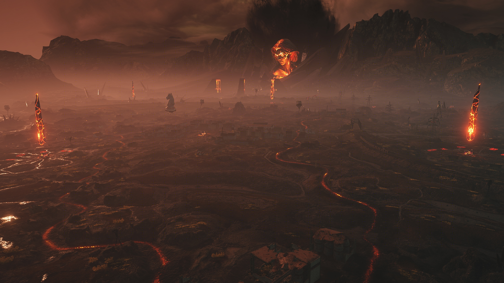

Новые враги - старые мотивы. Встречайте операцию «Пекло»!
{: style="display: none" }

Танкисты!

Потусторонняя сила вырывается наружу, на сей раз вам предстоит бросить вызов Ратте во владениях Левиафана, [правила вам уже знакомы](https://tanki.su/ru/razlom-2026/), поэтому мы пройдемся по основным изменениям.



### Карта

Освещение точь-в-точь было восстановленно из знакомого многим режима «Вторжение Левиафана», как на карте, так и в ангаре.

{: width="100%" }

### Саундтрек

Куда же без запоминающегося саундтрека, с нотками ностальгии по былым временам, «Левиафану» и мощностью в бою? Именно такой трек и написал для нашего события уже знакомый Вам [cherempet](https://www.youtube.com/@chrmpt). 

Каждый трек напомнит кому-то о чем-то своем. О Мирном-13, о Вторжении Левиафана и о рождении легенды.



Также вместе с саундтреком в модификации изменилась и озвучка на соответствующую.

### Где скачать?

Установить модификацию можно в основном установщике модов «WoT это Классика!».

---

Удачи на полях потусторонних сражений, танкисты!

И увидимся уже в декабре. ;p